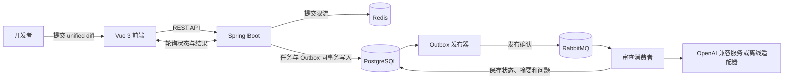

# PatchPilot

PatchPilot 是一款面向代码变更的 AI 审查工作台。开发者提交 unified diff，系统将审查放入异步任务队列，由可配置的模型服务分析变更，再返回审查摘要和结构化问题，便于按严重级别、文件位置和修改建议逐项处理。

PatchPilot 将审查任务、消息分发和模型调用拆成独立环节：API 快速接收请求，后台消费者负责分析，前端持续展示任务状态和结果。当前前端通过手动粘贴 diff 提交，不会扫描或读取本地仓库。

## 核心功能

- **变更审查输入**：提交标题、unified diff，以及可选的 base/head 分支信息；后端验证 diff 格式并限制单次内容不超过 200 KiB。
- **异步任务跟踪**：任务经过排队、处理中、完成或失败等状态；前端自动刷新进度，并提供历史任务列表和详情查看。
- **结构化审查结果**：模型返回整体摘要和问题列表。每项问题包含严重级别、规则标识、文件路径、行号、原因说明和修改建议。
- **模型服务可配置**：支持 OpenAI Chat Completions 兼容接口，模型名称、服务地址、提示词版本、温度和超时均可配置；也提供不调用外部服务的离线适配器。
- **可靠的后台处理**：PostgreSQL 事务同时写入审查任务和 Outbox 事件；发布器收到 RabbitMQ 确认后标记事件，消费者负责模型分析，失败任务按策略重试并进入死信队列。
- **提交保护与去重**：Redis 按客户端地址限制提交频率，默认每 60 秒最多 10 次；API 使用 `Idempotency-Key` 处理重复请求。
- **分页和输入限制**：任务与问题列表使用游标分页，API 每页最多返回 100 条；提交前后都会校验 diff 大小和格式。

## 工作流程



提交接口先校验请求并持久化任务，返回受理状态；Outbox 发布器随后将任务事件送入 RabbitMQ。消费者读取任务，调用当前配置的模型适配器，校验结构化结果并保存到 PostgreSQL。前端在任务处理中每 4 秒刷新状态，完成后展示摘要和问题详情。

## 使用方式

1. 在目标 Git 仓库的终端生成改动并复制到剪贴板。

   macOS：

   ```sh
   git diff HEAD | pbcopy
   ```

   Windows PowerShell：

   ```powershell
   git diff HEAD | Set-Clipboard
   ```

   新建文件默认不会包含在 Git diff 中；如需审查新文件，先运行 `git add -N 文件路径`，再执行对应平台的命令。

2. 在 PatchPilot 的“代码审查”页填写标题并粘贴 diff。Base ref 和 Head ref 是可选项。

3. 提交后在任务列表中查看排队和处理状态。任务完成后查看摘要、问题位置、严重级别和修改建议。

默认离线适配器不会调用 AI，也不会生成语义审查问题。配置真实模型服务后，审查标题、diff 和填写的分支信息会发送至配置的模型接口；请勿提交密钥、`.env`、个人数据或不应发送到该服务的代码。

## 技术架构

| 模块 | 技术 | 职责 |
| --- | --- | --- |
| 前端 | Vue 3、TypeScript、Vite | 提交 diff、刷新任务状态、展示审查结果 |
| 后端 | Java 21、Spring Boot | REST API、请求校验、审查任务编排 |
| 持久化 | PostgreSQL | 审查请求、Outbox 事件、摘要和问题结果 |
| 消息队列 | RabbitMQ | 解耦 API 请求与模型审查任务，支持重试与死信处理 |
| 限流 | Redis | 在共享存储中统计客户端提交次数 |
| 模型 | OpenAI 兼容 Chat Completions API | 按提示词版本分析 diff 并返回 JSON 结构结果 |

后端 API 契约见 [`api/openapi.yaml`](api/openapi.yaml)。提示词按版本保存在 `backend/src/main/resources/prompts/`，便于迭代和进行离线评测。

## 快速开始

### 环境要求

- Java 21
- Node.js 22.12 或更新版本
- Docker Desktop 和 Docker Compose v2

### 启动完整服务

在项目根目录运行：

```sh
cp .env.example .env
docker compose up --build
```

前端地址：<http://localhost:5173>。后端健康检查：<http://localhost:8080/actuator/health>。RabbitMQ 管理页面：<http://localhost:15672>。

PostgreSQL、RabbitMQ 和 Redis 默认使用 5432、5672 和 6379 端口；如端口冲突，可在 `.env` 中修改。Compose 在 `.env` 不存在时也使用本地开发默认值。示例数据库和 RabbitMQ 密码仅供本机开发，不要用于公开服务器。

### 配置模型服务

如需真实模型分析，在 `.env` 中配置 OpenAI 兼容服务地址、密钥和模型名称：

```dotenv
PATCHPILOT_MODEL_PROVIDER=openai
PATCHPILOT_OPENAI_BASE_URL=https://api.openai.com/v1
PATCHPILOT_OPENAI_API_KEY=填入你自己的密钥
PATCHPILOT_OPENAI_MODEL=gpt-4o-mini
```

保存后重启服务。默认值 `PATCHPILOT_MODEL_PROVIDER=offline` 使用离线适配器，不会向外部模型发送请求。真实 API 密钥应放在未跟踪的 `.env` 或环境变量中，不要提交到 Git。

## 本地端到端验证

以下流程在 Docker 中启动 PostgreSQL、RabbitMQ 和 Redis，在本机运行后端、前端和确定性模型模拟器。模拟器只接受指定测试 diff 并返回固定结果，不访问网络，也不代表真实模型效果。

先启动基础服务：

```sh
docker compose up -d postgres rabbitmq redis
```

在单独终端启动模型模拟器：

```sh
node tools/e2e/mock-openai.mjs
```

在另一个终端启动后端：

```sh
cd backend
SERVER_PORT=8080 \
DATABASE_URL=jdbc:postgresql://127.0.0.1:5432/patchpilot \
DATABASE_USERNAME=patchpilot \
DATABASE_PASSWORD=patchpilot-local \
RABBITMQ_HOST=127.0.0.1 \
RABBITMQ_PORT=5672 \
RABBITMQ_USERNAME=patchpilot \
RABBITMQ_PASSWORD=patchpilot-local \
REDIS_HOST=127.0.0.1 \
REDIS_PORT=6379 \
PATCHPILOT_MODEL_PROVIDER=openai \
PATCHPILOT_OPENAI_BASE_URL=http://127.0.0.1:18081/v1 \
PATCHPILOT_OPENAI_API_KEY=local-e2e-only \
./mvnw spring-boot:run
```

再开一个终端启动前端：

```sh
cd frontend
npm ci
VITE_API_TARGET=http://127.0.0.1:8080 npm run dev
```

打开 <http://localhost:5173>，标题可填 `E2E: nullable account name`，并提交以下 diff：

```diff
diff --git a/src/Account.java b/src/Account.java
index 1234567..89abcde 100644
--- a/src/Account.java
+++ b/src/Account.java
@@ -1,2 +1,3 @@
 class Account {
+    void rename(String name) { System.out.println(name.trim()); }
 }
```

任务应从“排队中”变为“已完成”，并显示 `src/Account.java:2` 的 `HIGH` 级别 `NULL_DEREFERENCE` 问题。该流程会验证浏览器、API、PostgreSQL、Outbox、RabbitMQ 消费者、模型适配器和结果展示，不会把代码发送到外部模型服务。

基础服务运行期间，可以执行浏览器冒烟测试：

```sh
node tools/e2e/browser-smoke.mjs
```

该测试需要模型模拟器、后端、前端和 Chrome/Chromium。如果浏览器不在默认路径，请通过 `CHROME_BIN` 指定可执行文件。

## 测试与检查

后端测试：

```sh
cd backend
./mvnw verify -Pintegration,prompt-eval
```

前端测试和生产构建：

```sh
cd frontend
npm ci
npm test -- --run
npm run build
```

Compose 配置检查：

```sh
docker compose config
```

`prompt-eval` 使用固定离线样例，不用于衡量真实模型质量。如需生成真实模型评测报告，请配置模型服务密钥后运行 `./mvnw -Preal-model-eval verify`；该评测会调用外部模型服务。

## 数据与安全

审查任务和 diff 在排队、处理期间保存在 PostgreSQL。使用 OpenAI 兼容模型时，后端会将审查标题、diff 和可选的 base/head 分支信息发送到配置的服务地址。API 错误和应用日志不会记录原始模型响应或凭据。本地模型模拟器只用于测试，并返回固定样例结果。
